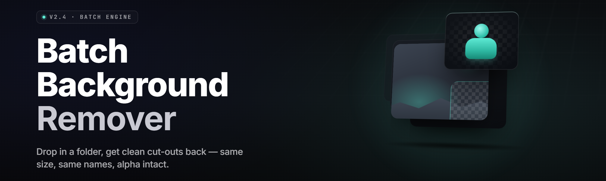

  
  
  

  

  
  

---

**Batch background remover — Pro 2026**

Drop a folder of 2,000 product shots. Walk away. Come back to transparent PNGs, named, trimmed, and ready for upload.

---

Potato oils up, absolute potato — chef said "batch it" so we batch it, whole folder in one drag, 6767. Some other vegetable in the crisper is still asking "want me to do these one at a time?" — nah gng, we're not flinching at 2,000 files.

---

## 📦 Overview

**batch-background-remover** is a Windows `.exe` that eats an entire directory of images and spits out clean cutouts — no cloud, no login, no per-image quota. You point it at a folder, pick an output format, hit run, and the tater chews through the whole pile while you make coffee.

| Category | Details |
| --- | --- |
| **Distribution** | Standalone `.exe` — extract and run, no Python, no pip, no git |
| **Engine** | Local ONNX segmentation model (U²-Net class), bundled in the release |
| **Batch capacity** | Tested to ~12,000 images per run on a single NVMe volume |
| **Formats in** | PNG, JPG, JPEG, WEBP, BMP, TIFF, AVIF |
| **Formats out** | Transparent PNG, WEBP (lossy/lossless), JPG on matte, mask-only PNG |
| **Modes** | Auto (subject detect), Portrait, Product, Animal, Logos/Graphics |
| **Hardware** | CPU fallback + optional CUDA / DirectML / ROCm acceleration |
| **Overwrite policy** | Non-destructive by default — writes to `_cutout/` beside source |

The 2026 build is a rewrite of the batch scheduler: three concurrent worker pools (decode, infer, encode) so the GPU never waits on disk and disk never waits on GPU. On a mid-range RTX card it holds roughly 40–55 images/second at 2K input; on CPU-only it chugs along at a respectable 1.5–3 img/s depending on core count and source resolution.

  

---

## 🗂️ Table of Contents

- [Key Features](#-key-features)
- [The Problem](#-the-problem)
- [The Solution](#-the-solution)
- [Quick Start](#-quick-start)
- [What is Batch Background Removal](#-what-is-batch-background-removal)
- [Compatibility](#-compatibility)
- [Usage Guidelines](#-usage-guidelines)
- [System Requirements](#-system-requirements)
- [Module Catalog](#-module-catalog)
- [Installation](#-installation)
- [Known Issues](#-known-issues)
- [FAQ](#-faq)

---

## 🧰 Key Features

| Feature | Description | Benefit |
| --- | --- | --- |
| **Whole-folder ingest** | Recursively scans a directory tree for supported images | One drag, thousands processed |
| **Per-mode segmentation** | Distinct ONNX weights for portrait, product, animal, graphics | Cutouts that respect the subject type |
| **Alpha matting refine** | Optional trimap + matting pass for hair and fur edges | No crunchy halos on soft edges |
| **CPU/GPU auto-select** | Probes available accelerators at launch, falls back gracefully | Works on a potato laptop or a 4090 rig |
| **Non-destructive output** | Writes to a sibling folder, never touches originals | Zero risk to your source library |
| **Name-preserving** | Output filenames mirror input 1:1 | Pipeline-friendly for e-commerce uploads |
| **Mask export** | Dump the raw alpha as a separate PNG | Reuse the mask in your own compositor |
| **Preset profiles** | Save engine + format + matte settings as a named profile | Same result every run, no re-clicking |
| **Collision policy** | Skip / overwrite / suffix (`_1`, `_2`) on duplicate names | Predictable batch re-runs |
| **Dry-run mode** | List what would be processed without writing | Sanity-check before a 10k run |
| **Watch folder** | Auto-pick up images dropped while the tool is open | Set-and-forget drop-box |
| **Post-run report** | CSV of input path, output path, timing, mean alpha coverage | Auditable batch logs |

---

## 🩹 The Problem

- Doing cutouts one image at a time in a web editor with a 5-per-hour cap.
- Subscription background removers that price per image and stall at 200 in a folder.
- Browser uploaders that choke and time out the moment a batch crosses a few hundred files.
- Cloud tools that recompress your full-resolution originals down to 1024px.
- Manual actions — selecting, masking, saving, exporting — for images that all need the same operation.
- A hair's-width halo on the edge because the auto tool skipped the matting pass entirely.
- No way to re-run last week's exact settings without screenshotting your own GUI.

---

## 🛠️ The Solution

| Problem | Solution |
| --- | --- |
| Per-image web editors | One folder ingest, whole batch in a single run |
| Per-image pricing | Local `.exe`, no quotas, no metering, no account |
| Browser timeouts on large batches | Native worker pools, no upload, no HTTP round-trips |
| Downscaling cloud tools | Full-resolution processing at native pixel dimensions |
| Manual per-image masking | Single engine pass handles the entire folder |
| Soft-edge halos | Optional alpha matting refine pass on hair and fur |
| Lost settings between runs | Named preset profiles persist to disk |

---

## 🪜 Quick Start

1. 📂 **Visit the project page** and grab the latest release build.
2. 📦 **Download the archive** and extract to any folder you own (avoid `Program Files`).
3. 🖱️ **Run the `.exe`** — first launch unpacks the model into `%LOCALAPPDATA%\batch-background-remover\`.
4. 🚀 **Drag your source folder** onto the window (or browse to it) and pick a preset.
5. ✅ **Hit Run** — watch the progress bar; results land in `_cutout/` beside the source.

---

## 🔍 What is Batch Background Removal

| Term | Explanation |
| --- | --- |
| **Segmentation** | A model marking every pixel as foreground or background — the core step. |
| **Matting** | A refinement pass producing fractional alpha for soft edges (hair, fur, glass). |
| **Trimap** | A three-zone map (foreground / unknown / background) fed to the matting pass. |
| **Alpha channel** | The 0–255 transparency byte per pixel; PNG and WEBP preserve it. |
| **Batch** | A set of images processed with identical settings in one run. |
| **Mode** | The preset weights selected for a subject class (portrait, product, etc.). |
| **Collision policy** | What the tool does when an output filename already exists. |
| **Mean alpha coverage** | Average fraction of pixels retained — a quick QA signal per file. |

The whole point of a *batch* tool is that the operation is identical across thousands of files. You configure once, and the engine repeats deterministically. This build keeps that promise: same preset, same model version, same output.

---

## 🖥️ Compatibility

| OS | Version | Status |
| --- | --- | --- |
| Windows | 10 21H2+ | ✅ Fully supported (primary target) |
| Windows | 11 22H2+ | ✅ Fully supported |
| Linux | Ubuntu 22.04+, glibc 2.35+ | ✅ AppImage build |
| macOS | 13+ (Apple Silicon) | ⚠️ Community build, not official |
| Windows | 8.1 | ⚠️ Runs, no CUDA accel, unsupported |

---

## 📋 Usage Guidelines

| Allowed | Not allowed |
| --- | --- |
| Personal and commercial image processing | Redistributing the model weights as your own |
| Batch processing your own photo library | Reselling the `.exe` as a proprietary product |
| Integrating the CLI into internal pipelines | Removing the MIT license headers |
| Processing product catalogs at any scale | Using the tool to strip copyright watermarks |
| Modding the config and shipping presets | Claiming original authorship of the engine |

---

## 🧮 System Requirements

| Component | Minimum | Recommended |
| --- | --- | --- |
| **OS** | Windows 10 21H2 (x64) | Windows 11 23H2 (x64) |
| **CPU** | 4 cores / SSE4.2 | 8+ cores, AVX2 |
| **RAM** | 4 GB | 16 GB+ |
| **GPU** | Any DirectX 12 capable | NVIDIA RTX 20-series+ / AMD RX 6000+ |
| **VRAM** | 2 GB (if GPU) | 6 GB+ |
| **Disk** | 600 MB for app + model | 2 GB (working cache for large batches) |
| **Display** | 1280×720 | 1920×1080 |

---

## 🧩 Module Catalog

### 🎯 Ingest & Discovery

- **FolderWalker** — recursive scan with extension + size filters, follows or ignores symlinks per flag.
- **ExtensionFilter** — configurable allowlist; defaults to the seven supported image types.
- **DuplicateDetector** — hashes the first 64 KB of each file to skip repeats without full reads.
- **ManifestBuilder** — collects the full queue up front so progress and dry-run are accurate.

### 🧠 Segmentation Core

- **ModelLoader** — loads the ONNX graph, caches it in `%LOCALAPPDATA%`, refreshes on version bump.
- **ModeRouter** — maps the chosen mode to the correct weight file and input normalization profile.
- **InferencePool** — N workers over a bounded queue; single-in-flight per device to avoid VRAM thrash.
- **TileSplitter** — splits oversized images into tiles with overlap, stitches with feathering.
- **EdgePostProcess** — morphological cleanup and despeckle on the raw alpha.

### 🎨 Matting & Refine

- **TrimapGenerator** — dilates and erodes the mask to build the unknown band.
- **AlphaMattePass** — guided-filter / closed-form matting for hair and fur edges.
- **DefringeDeblur** — pulls background color bleed out of semi-transparent pixels.
- **HaloSuppressor** — removes the classic one-pixel light rim on dark backdrops.

### 💾 Output & Pipeline

- **FormatEncoder** — PNG / WEBP / JPG-on-matte encoder with per-format quality knobs.
- **NameMirrorer** — preserves relative path and basename, writes into `_cutout/`.
- **CollisionResolver** — skip / overwrite / suffix strategies with a persistent ledger.
- **ReportWriter** — emits a run CSV with timings and mean alpha coverage per file.
- **WatchFolder** — directory watcher that enqueues new files within a debounce window.

### ⚙️ Runtime & Config

- **AcceleratorProbe** — detects CUDA, DirectML, ROCm, falls back to CPU cleanly.
- **PresetStore** — JSON-backed preset profiles under `%APPDATA%`.
- **CLIRunner** — headless mode (`--input`, `--preset`, `--out`) for pipelines and scheduled tasks.
- **Logger** — rotating file log with levels; `--verbose` mirrors to console.
- **CrashReporter** — writes a local dump + last-100-lines log on unhandled faults.

### 🖼️ UI Layer

- **DropTarget** — drag-and-drop handler for folders and files.
- **ProgressView** — per-file and aggregate progress with ETA from a rolling mean.
- **PreviewPane** — side-by-side before/after for the currently active file.
- **ThemeEngine** — light / dark / follow-system, persisted per user.

<b>Internal modules (advanced)</b>

- **TensorCache** — reuses input buffers across images to cut allocation churn.
- **BatchCoordinator** — schedules decode / infer / encode stages across three pools.
- **DeviceMonitor** — samples VRAM + thermals; throttles the pool if the GPU saturates.
- **ResultVerifier** — sanity-checks output dimensions and alpha bounds before commit.
- **UpdateChecker** — optional, off by default; compares local version against a manifest.
- **ConfigMigrator** — upgrades old preset files when the schema changes.
- **TelemetryStub** — compiled no-op; no network calls are ever made from this build.

---

## 📥 Installation

1. **Download the release archive.** Grab `batch-background-remover-2026-win64.zip` from the project page. Verify the SHA-256 shown next to the release if you care about integrity — it's printed for a reason.
2. **Extract to a writable folder.** Right-click → Extract All to something like `C:\Tools\bbr`. Do not place it under `Program Files` — the tool writes presets and a model cache next to its own config and a locked directory will bite you.
3. **First-run model unpack.** Double-click the `.exe`. On first launch it extracts the bundled ONNX model into `%LOCALAPPDATA%\batch-background-remover\models\` (≈ 480 MB). Subsequent launches are instant.

That's the whole install. No driver bundles, no VC++ redist, no admin prompt — unless you want CUDA acceleration, in which case have a recent NVIDIA driver installed and the app picks it up automatically.

---

## 🐛 Known Issues

| Issue | Solution |
| --- | --- |
| First launch appears frozen for ~30s | It's unpacking the model. Wait; you'll only see this once. |
| CUDA not detected on a supported GPU | Update to driver ≥ 550; re-run — the probe rescans at launch. |
| Halo on dark backgrounds after fast mode | Enable the matting refine pass in the preset; costs ~2× time. |
| WEBP output looks softer than PNG | Bump the WEBP quality to 95+ or use lossless mode. |
| Very large TIFFs fail to decode | Convert to PNG first, or drop the file under the 200 MP guard. |

---

## ❓ FAQ

<b>Does it phone home or upload my images?</b>

No. All processing is local. The bundled build has no network code in the processing path. The optional update checker is off by default and only fetches a version manifest if you turn it on.

<b>Can I run this without a GPU?</b>

Yes. The CPU path is fully supported and auto-selected when no accelerator is found. Expect roughly 1.5–3 images/second at 2K resolution on a modern 6-core CPU.

<b>Why do some edges still look crunchy?</b>

Fast mode skips the matting refine pass. Enable "Refine edges (matting)" in the preset for hair, fur, and anything semi-transparent. It roughly doubles runtime but gives the clean edge.

<b>Can I integrate this into a scheduled pipeline?</b>

Yes — run the `.exe` with `--headless --input <dir> --preset <name> --out <dir>`. It returns exit code 0 on success and writes the CSV report to the output folder.

<b>Can I use the output commercially?</b>

The tool is MIT. The model weights shipped with the release carry their own license — check the `LICENSE.model` file in the archive before commercial redistribution of the weights themselves (not the outputs).

**Q:** Will it work on a network drive?
**A:** It will, but slowly. Decode and encode dominate; copy the folder local first for large runs.

**Q:** Does it preserve EXIF?
**A:** Only on PNG and JPG output when "Preserve metadata" is enabled in the preset. WEBP output strips it.

**Q:** What's the largest batch it handles?
**A:** No hard cap. Practically, we've run ~12,000 files in a single session without issue. Memory scales with worker count, not queue length.

**Q:** Can I pause and resume? **A:** Pause, yes. Resume from a partial run — close the app and re-run with the same preset; files already present in the output folder are skipped per your collision policy.

---

There's a folder full of raw shots waiting for cutouts, and there's a tater in the fridge that eats folders whole. Point it at the pile, pick a preset, walk away. When you're back, the batch is done and the files are named exactly the way you left them — just transparent.

  

absolute potato to you, Sam.
